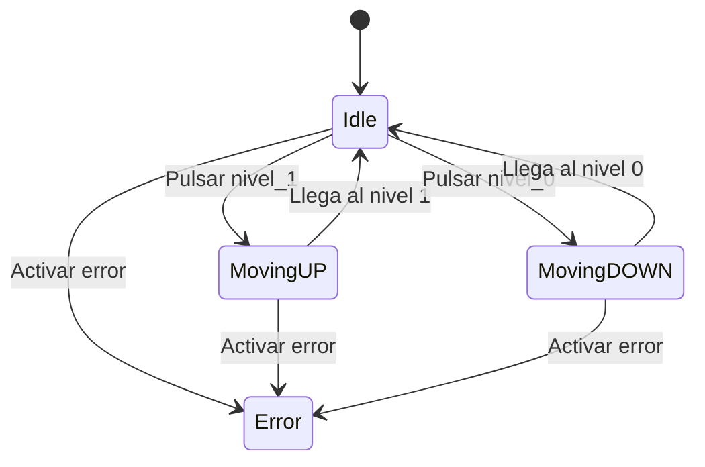

# Máquina de estados - Halo de Vigo

## 1. Introducción

Este proyecto consiste en simular el funcionamiento del mecanismo del Halo de Vigo mediante una máquina de estados programada en Kotlin.

El mecanismo puede estar parado en uno de los dos niveles, subir, bajar o encontrarse en un estado de error.

## 2. Niveles del mecanismo

El mecanismo utiliza la variable `nivel_actual` para indicar su posición.

| Valor | Significado |
|---|---|
| `0` | Avenida de García Barbón |
| `1` | Plaza de Compostela |
| `2` | El mecanismo está en movimiento |
| `-1` | El mecanismo está en estado de error |

Al iniciar el programa, el mecanismo se encuentra en el nivel `0`.

## 3. Estados

Los estados están definidos en el archivo `Estados.kt` mediante una `sealed class`.

Los estados utilizados son:

- **Idle:** el mecanismo está parado y puede recibir una orden de movimiento.
- **MovingUP:** el mecanismo está subiendo hacia el nivel 1.
- **MovingDOWN:** el mecanismo está bajando hacia el nivel 0.
- **Error:** el mecanismo tiene un error y no puede realizar movimientos.

## 4. Funcionamiento del programa

El proyecto está dividido en varios archivos Kotlin.

### `Estados.kt`

Contiene la definición de los cuatro estados posibles del mecanismo.

### `Gestor.kt`

Contiene las variables y funciones que controlan el funcionamiento de la máquina:

- `nivel_actual`: almacena el nivel o la situación actual del mecanismo.
- `estado_actual`: indica en qué estado se encuentra.
- `nivel_0()`: solicita bajar al nivel 0 si el mecanismo está parado en el nivel 1.
- `nivel_1()`: solicita subir al nivel 1 si el mecanismo está parado en el nivel 0.
- `gestor()`: gestiona el cambio de estado y completa el movimiento.
- `activarError()`: cambia el estado a error y establece el nivel en `-1`.

### `Main.kt`

Contiene la función `main()`, que permite probar el funcionamiento del mecanismo mostrando por pantalla los estados y niveles durante una subida y una bajada.

### `HaloTest.kt`

Contiene las pruebas unitarias realizadas con JUnit 5 para comprobar el funcionamiento del programa.

## 5. Transiciones entre estados

Las principales transiciones son:

1. Desde `Idle`, al solicitar el nivel 1, el mecanismo pasa a `MovingUP`.
2. Cuando termina la subida, llega al nivel 1 y vuelve a `Idle`.
3. Desde `Idle`, al solicitar el nivel 0, el mecanismo pasa a `MovingDOWN`.
4. Cuando termina la bajada, llega al nivel 0 y vuelve a `Idle`.
5. Si se activa un error, el mecanismo pasa a `Error` y el nivel se establece en `-1`.
6. Mientras el mecanismo se mueve o está en error, no puede iniciar otro movimiento mediante los botones.

### Diagrama de estados

## 6. Pruebas unitarias

Las pruebas de `HaloTest.kt` comprueban que:

- El mecanismo comienza en el nivel 0 y en estado `Idle`.
- La subida y la bajada comienzan correctamente.
- Al finalizar cada movimiento, el mecanismo llega al nivel correspondiente.
- No se inicia un movimiento si ya está en el nivel solicitado.
- No se inicia otro movimiento mientras el mecanismo está en movimiento.
- El estado de error impide realizar movimientos.

Para ejecutar las pruebas desde IntelliJ IDEA, abre `HaloTest.kt` y pulsa el botón de ejecución situado junto a la clase o a cada prueba.

## 8. Conclusión

Con este proyecto se practica el uso de máquinas de estados en Kotlin, el control de transiciones, la organización del código en diferentes archivos y la realización de pruebas unitarias para comprobar el funcionamiento del programa.
